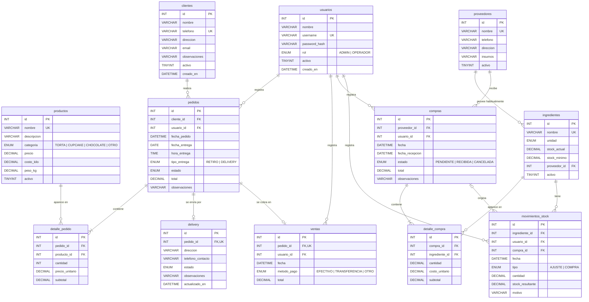

# Diagrama entidad-relación — Tortas y Chocolates 3B

Generado a partir de `database/01_schema.sql`. Si el script cambia, este diagrama se actualiza en la misma confirmación (*commit*).

Se ve como diagrama en GitHub, GitLab o VS Code con la extensión "Markdown Preview Mermaid Support". Para exportarlo como imagen se puede pegar en https://mermaid.live.

## Resumen de relaciones

| Relación | Cardinalidad | FK |
|---|---|---|
| clientes → pedidos | 1 : N | pedidos.cliente_id |
| usuarios → pedidos / ventas / compras / movimientos_stock | 1 : N | usuario_id |
| pedidos → detalle_pedido | 1 : N (borrado en cascada) | detalle_pedido.pedido_id |
| productos → detalle_pedido | 1 : N | detalle_pedido.producto_id |
| pedidos → delivery | 1 : 0..1 | delivery.pedido_id (UNIQUE) |
| pedidos → ventas | 1 : 0..1 | ventas.pedido_id (UNIQUE) |
| proveedores → ingredientes | 1 : N (opcional; SET NULL) | ingredientes.proveedor_id |
| proveedores → compras | 1 : N | compras.proveedor_id |
| compras → detalle_compra | 1 : N (borrado en cascada) | detalle_compra.compra_id |
| ingredientes → detalle_compra | 1 : N | detalle_compra.ingrediente_id |
| ingredientes → movimientos_stock | 1 : N | movimientos_stock.ingrediente_id |
| compras → movimientos_stock | 1 : N (opcional) | movimientos_stock.compra_id |
